# LEGO Dimensions — Virtual Toy Pad for PS5 (console picker + phone remote)

Play the **PS4 version of LEGO Dimensions on a jailbroken PS5 without the physical Toy Pad**.
One ELF payload gives you:

- **A virtual Toy Pad** the game believes is plugged in — every character, vehicle and gadget,
  with saved vehicle upgrades.
- **An on-screen picker on the TV**, a port of harrysof's
  [LegoToypad](https://github.com/harrysof/LegoToypad) drawn by the PS5 system UI: pads with
  **live toypad LEDs**, worlds, rosters, vehicle builds, favourites, sorts, **search**, a
  **sneak peek** while you play and a **Settings** screen.
- **A phone remote** — LegoToypad's own web app served by the PS5 to any phone on your Wi-Fi.
- **60 FPS** and **1440p / 2160p internal resolution** patches (connorh315's patches).

Built on top of **HeitorSpectre's [Virtual Toy Pad](https://github.com/HeitorSpectre/Virtual-Toy-Pad)**
(see [Credits](#credits)).

> **[Download the latest release](../../releases/latest)** — `VirtualToyPad.elf` plus the
> ready-made `data/ldmod` folder.

---

## Screenshots

**On a PS5** (an earlier build of the picker, filmed off the TV):

| Picker over the game | World grid | Sneak peek in gameplay |
|---|---|---|
| 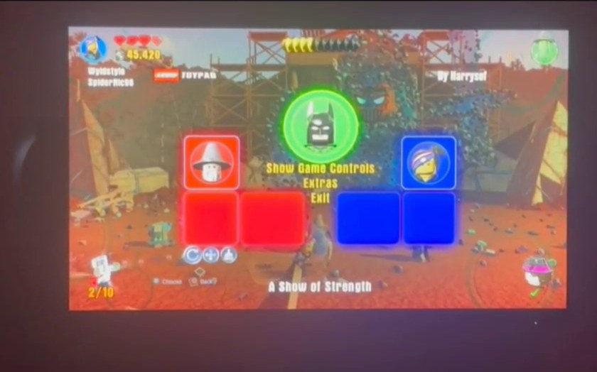 | 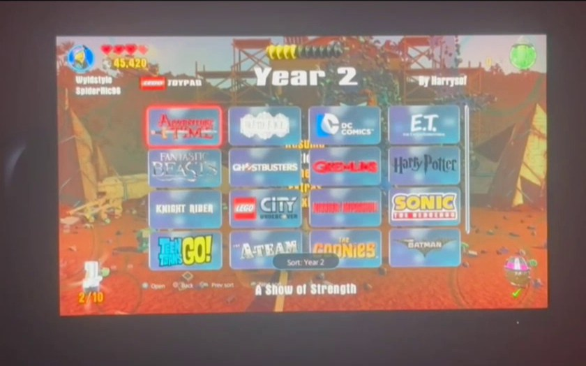 | 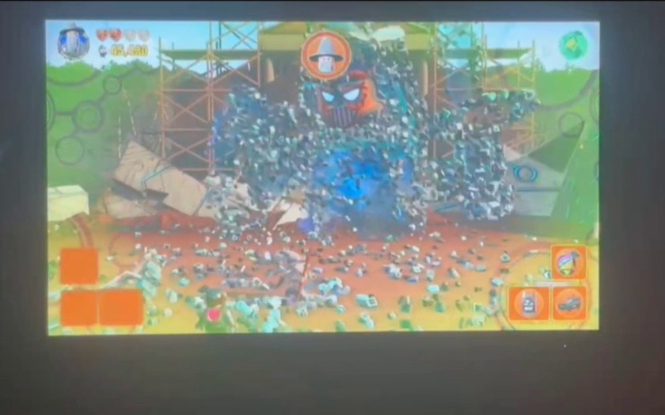 |

**Current version** (rendered by the PC preview of the console overlay — same code and art):

| Toypad with realistic LEDs | Load / Move / Clear |
|---|---|
| 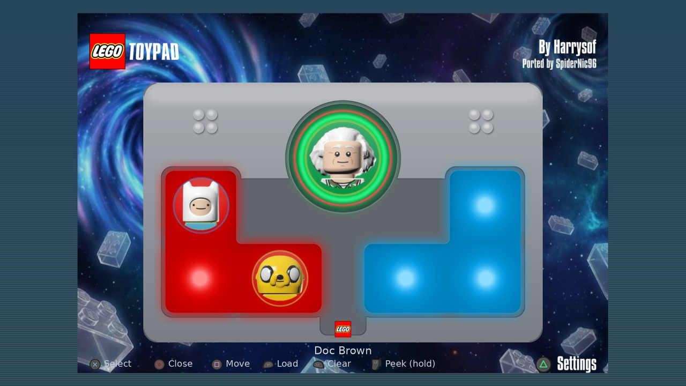 | 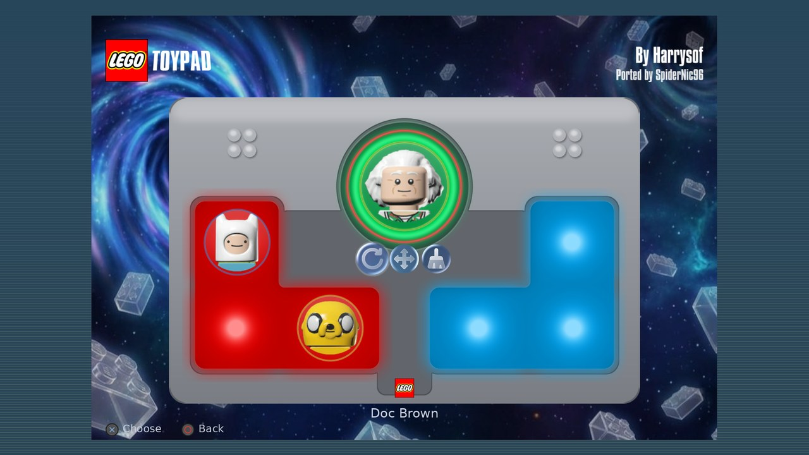 |
| **Worlds (sorts: Default, Year 1, Year 2, User, Favorites, Story)** | **Roster with vehicles** |
| 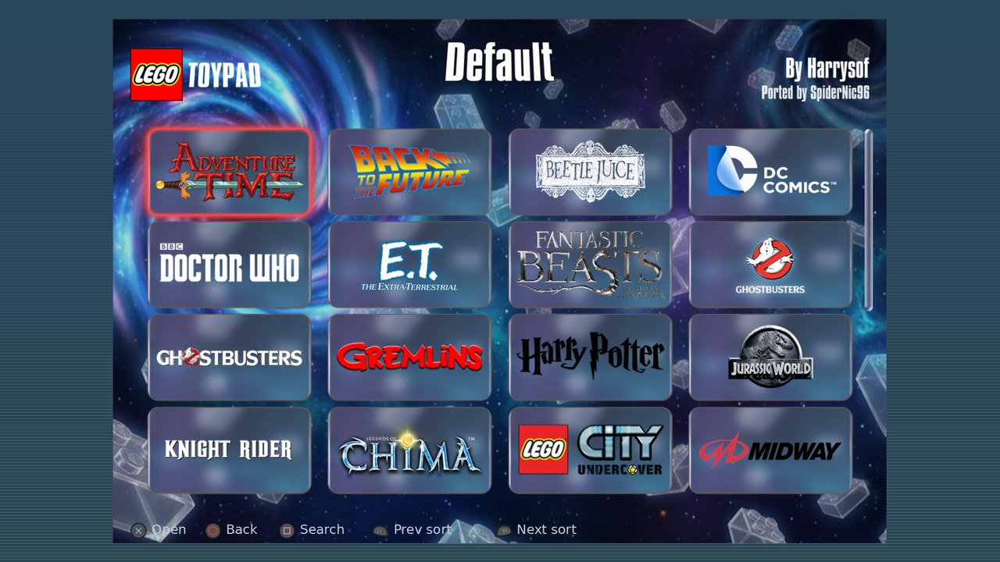 | 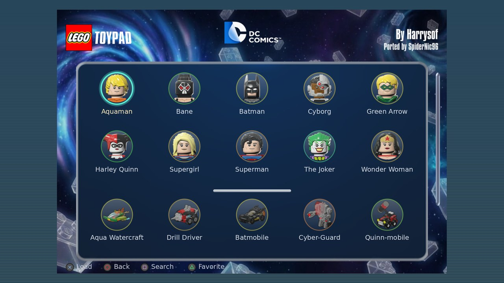 |
| **Search with the on-screen keyboard** | **Settings** |
| 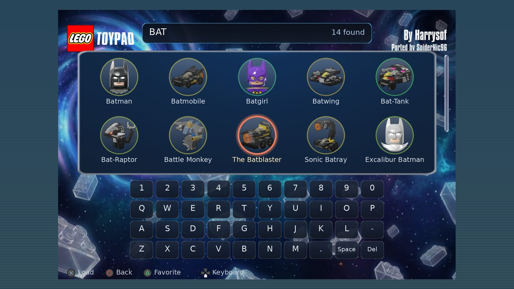 | 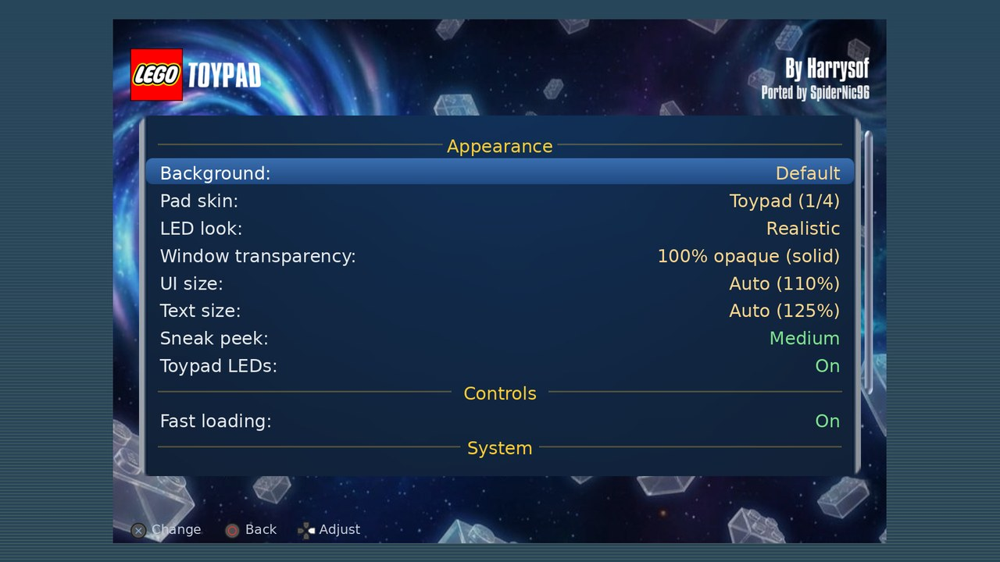 |

| Sneak peek (hold L2) | Phone remote | Phone remote: worlds |
|---|---|---|
| 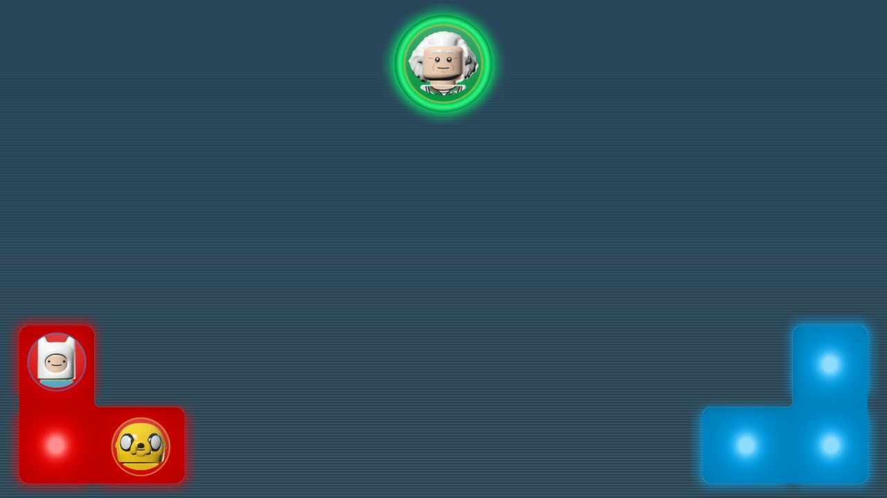 | 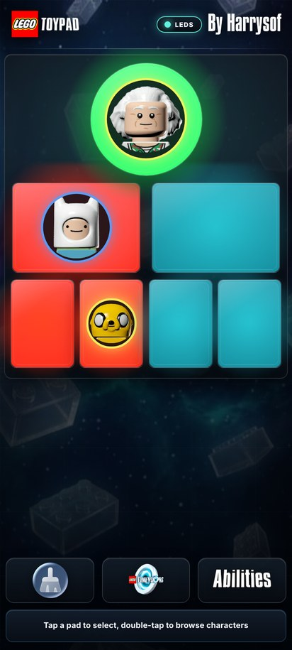 | 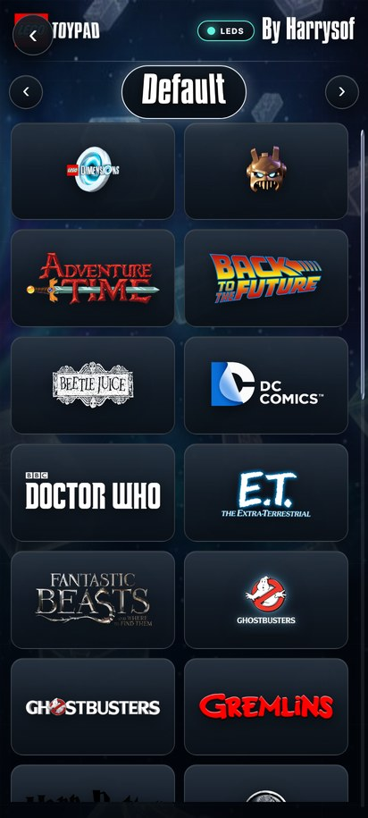 |

---

## Compatibility

| | |
|---|---|
| **Game** | LEGO Dimensions (PS4), **EU CUSA01176 update 1.24** or **US CUSA00935 update 1.23** |
| **Install type** | Disc + update, PKG or fPKG — anything that runs those exact versions. The payload checks the game's code before patching and refuses other versions (a disc without its update is v1.00). |
| **Console** | Jailbroken PS5 on **7.00 to 13.60** with an ELF loader (etaHEN, elfldr...). Developed on firmware 13.60 (kstuff lite, etaHEN, ShadowMountPlus). The console picker hooks ShellUI's frame update on 7.00–8.20 and 11.00–13.60 (and on 9.60 with etaHEN), and uses its own render thread on 8.40–8.60, 9.00–9.60 and 10.xx. Only 13.60 has been run on a console. On a firmware where ShellUI can't be patched safely it puts the original bytes back: you get no console picker, and the phone remote still works. |
| **Phone** | Any phone browser on the same network |

The console picker draws itself inside SceShellUI. **Don't run another ShellUI overlay at the same
time** (Common FPS, SimpleFPS, HUD overlays...). If the picker can't start, the payload falls back to
HeitorSpectre's original in-game text menu automatically.

---

## Install

1. **Close LEGO Dimensions** completely (not suspended).
2. Download the release zip and unzip it on your PC. Copy its `data/ldmod` folder to the PS5 over
   FTP so that you end up with:
   ```
   /data/ldmod/web/index.html        <- phone remote
   /data/ldmod/web/ui/catalog.tsv    <- console picker art
   ```
   (`config.ini`, saved figures in `tags/`, favourites and logs are created there by the payload.)
3. Send **`VirtualToyPad.elf`** to your ELF loader (etaHEN payload menu, or port 9021).
   Sending it again later replaces the running copy.
4. Start LEGO Dimensions. Wait for the **"Virtual Toy Pad connected!"** notification, then about
   5-10 seconds while the picker loads into the system UI.
5. Hold **L3 + R3** in game.

**Updating:** close the game, replace `/data/ldmod/web` with the new one, send the new ELF.
Settings, favourites and saved figures stay.

---

## Using it on the console

Hold **L3 + R3** (`menu_buttons` in `config.ini`) to open or close the picker. While it is open the
game doesn't receive your buttons; other players' controllers are paused too.

**Pad screen**

| Button | Action |
|---|---|
| D-pad / left stick | choose one of the 7 figure spots |
| **Cross** | open Load / Move / Clear for that spot |
| **Square** | move the figure (pick the destination, Cross to drop, Circle to cancel) |
| **R1** | go straight to loading a figure on that spot |
| **L1** | clear the spot |
| **Triangle** | Settings |
| **Circle** | close the picker |

**Worlds, rosters and vehicle builds**

| Button | Action |
|---|---|
| **Cross** | open the world / load the figure (vehicles with several builds open the build picker) |
| **Circle** | back |
| **L1 / R1** | previous / next sort: Default, Year 1, Year 2, User, Favorites, Story |
| **Triangle** | add / remove a favourite (gold star) |
| **Square** | **Search** |

**Search** — type with the on-screen keyboard; results update with every key and match figure
names, vehicle names and worlds ("BAT", "harry", "ghost"...). **Square** deletes a letter, **Up**
from the top row moves into the results, **Cross** loads, **Triangle** favourites.

**Sneak peek** — during gameplay hold **L2** (`peek_buttons`) to see the pads, their occupants and
the live LEDs in the screen corners (Small / Medium / Large, or Off).

**Fast loading** — on by default: the picker closes as soon as a figure is placed.

**Settings** (Triangle on the pad screen; everything is saved to `config.ini`)

| Row | Choices |
|---|---|
| Background | Default wallpaper, **Clear** (the game shows through), or 25 other LegoToypad wallpapers |
| Pad skin | **Toypad** (a real toypad: grey base, white L-shaped pads, clear centre), or LegoToypad's Default / Old / Plain |
| LED look | **Realistic** (light diffused through the pads, hot spots over the LEDs) or Flat (LegoToypad) |
| Window transparency | 20-100 % |
| UI size / Text size | Auto (110 % / 125 %, sized for a TV) or fixed sizes |
| Sneak peek | Off, Small, Medium, Large |
| Toypad LEDs | show the game's toypad lights or not |
| Fast loading | On / Off |
| Web remote | shows the address to open on your phone |
| Clear all pads / Reset all settings | one-shot actions |

The LEDs are decoded from the game's own Toy Pad commands (colour, fade, flash) and shown with
LegoToypad's colour calibration. The realistic look follows the real hardware: one RGB LED under
each figure spot, white diffusers, a clear stand over the centre LED.

### Classic text menu

With `overlay=0` (or if the picker can't load) **L3 + R3** opens HeitorSpectre's original menu,
drawn by the game: D-pad / left stick to move, **Cross** select, **Circle** back, **L1/R1**
character/vehicle category, **L2/R2** pages, **Square + D-pad / L2/R2 / Triangle** to adjust the
icon borders.

---

## Using it from your phone

The payload serves LegoToypad's phone app from the PS5 on **port 8765**:

1. Connect the phone to the same network as the PS5.
2. Open `http://<PS5 IP>:8765` — the exact address is shown in the console picker under
   **Settings → Web remote**.
3. Tap a pad to select it, double-tap to browse. Loading, moving and clearing figures, favourites,
   sorts and abilities work as in LegoToypad; the pads and LEDs follow the game live.

The phone and the TV picker share the same pads, favourites, sort order and LED switch, so you can
use either at any time. There is no password: anyone on your network can use it.

---

## Frame rate and resolution

Both are set in **`/data/ldmod/config.ini`** and applied when the game starts (restart the game after
changing them):

```ini
# Patch the engine to target 60 FPS instead of 30 (connorh315's patch; 1/0)
fps60=1
# Internal render resolution: 1080 (game default), 1440 or 2160. If the game closes before the
# Toy Pad connects, the next start drops one step (delete res_fallback.txt to retry)
resolution=1080
```

- **`fps60=1`** (default) changes the engine's frame-rate target from 30 to 60. If the game code
  isn't the stock bytes (for example an fPKG with a 60 FPS patch already built in) it is left alone.
- **`resolution`** raises the internal render resolution; the console still outputs its usual video
  mode. 1440 and 2160 cost GPU time — if the frame rate dips, go back to 1080 or 1440.
- **2160 can crash the game.** The game keeps its PS4 memory budget on a PS5, and 4K render
  targets may not fit. Every start above 1080 is therefore a trial:
  - If the game closes before the toy pad connects, the next start drops one step
    (2160 → 1440 → 1080) and a notification tells you.
  - The drop is remembered in `/data/ldmod/res_fallback.txt`. Delete that file, or change
    `resolution=`, to try the higher setting again.
- Both patches are identical for EU v1.24 and US v1.23 and are verified before writing.

### All `config.ini` settings

| Key | Default | Meaning |
|---|---|---|
| `menu_buttons` | `L3+R3` | buttons that open/close the picker (L1 R1 L2 R2 L3 R3 CROSS CIRCLE SQUARE TRIANGLE UP DOWN LEFT RIGHT OPTIONS TOUCHPAD, joined with `+`) |
| `hold_ms` | `250` | how long to hold them |
| `overlay` | `1` | console picker on; `0` = classic text menu |
| `peek_buttons` / `peek_size` | `L2` / `2` | sneak peek buttons; 0 off, 1 small, 2 medium, 3 large |
| `fast_load` | `1` | close the picker after loading |
| `overlay_background` | `0` | 0 default, 1 Clear, 2-26 wallpapers |
| `overlay_opacity` | `92` | 20-100 |
| `pad_skin` | `0` | 0 Toypad, 1 Default, 2 Old, 3 Plain |
| `led_style` | `0` | 0 Realistic, 1 Flat |
| `ui_size` / `text_size` | `0` | 0 Auto, then 90/100/110/118 % and 100/115/130/150 % |
| `overlay_textures` | `0` | 0 auto, 1 pixel upload, 2 PNG files (try 2 if the art stays blank) |
| `fps60` | `1` | 60 FPS patch |
| `resolution` | `1080` | 1080, 1440 or 2160 |
| `force_fake` | `0` | use the virtual pad even with a real Toy Pad plugged in |
| `restore_pad` | `0` | put back the last session's figures at start |
| `draw_text` / `notify_menu` | `1` / `0` | classic menu: draw it / mirror it as notifications |

---

## Troubleshooting

- **No "Virtual Toy Pad connected"** — check the game version (EU 1.24 / US 1.23) and
  `/data/ldmod/ldinject.log` (`unsupported game version` means a different build).
- **L3 + R3 opens the old text menu** — the picker isn't loaded yet (wait a few seconds) or couldn't
  start: see `/data/ldmod/ldinject.log` and `/system_tmp/vtpovl_shellui.log`.
- **Picker shows but the art is blank** — set `overlay_textures=2`.
- **Log says "no retry for this ShellUI"** — rest mode and wake the PS5 (or reboot and re-jailbreak).
- **Phone page doesn't load** — the web folder must be at `/data/ldmod/web`; otherwise the log says
  `no bundle at /data/ldmod/web`.

---

## Building from source

On Linux or WSL you need:

- `clang`, `ld.lld`, `make`, a host C compiler, `xxd` (or `vim-common`), Python 3 with `pyelftools`,
  `pillow`, `numpy`, `fonttools` and `brotli`
- the [PS5 Payload SDK](https://github.com/ps5-payload-dev/sdk) (`PS5_PAYLOAD_SDK`, default
  `$HOME/ps5-payload-sdk`)

```bash
bash build.sh                         # -> build/ldinject.elf (the payload; renderer embedded)

git clone https://github.com/harrysof/LegoToypad
tools/make_web_bundle.sh LegoToypad   # -> build/web (copy it to /data/ldmod/web)
```

`build.sh` builds three parts: the game hook (`src/hook` → `ldhook.bin`, injected into the game),
the SceShellUI renderer (`src/overlay` → `vtp_shellui.elf`, checked for loader-safe relocations) and
the payload (`src/injector`) that embeds both. The web folder is generated from a LegoToypad
checkout: its phone app is copied unchanged, the catalogue, portraits and figure tags come from its
asset tables, and `tools/build_ui_pack.py` renders the console picker's art from its assets.

### Repository layout

| Path | What |
|---|---|
| `src/hook` | injected into the game: the virtual Toy Pad USB device, LED sniffer, classic menu, console-picker input hand-off |
| `src/core` | Toy Pad protocol and tag helpers |
| `src/injector` | the payload: injection, 60 FPS / resolution patches, phone remote (`webremote.c`), console picker (`cui.c`) |
| `src/overlay/controller` | loads the renderer into SceShellUI (from Common FPS) |
| `src/overlay/renderer` | the renderer running inside SceShellUI (PUI widgets, textures) |
| `src/overlay/shsrv` | John Törnblom's shsrv ELF loader and ptrace helpers |
| `tools` | web bundle and picker-art builders, renderer checker |
| `docs/screenshots` | README images |

---

## Contributors

<table>
  <tr>
    <td align="center"><a href="https://github.com/harrysof"><br/><b>harrysof</b></a><br/>LegoToypad: picker design, phone app, art</td>
    <td align="center"><a href="https://github.com/HeitorSpectre"><br/><b>HeitorSpectre</b></a><br/>Original Virtual Toy Pad</td>
    <td align="center"><a href="https://github.com/SpiderNic96"><br/><b>SpiderNic96</b></a><br/>PS5 port, console picker, phone remote</td>
  </tr>
</table>

## Credits

This project stands on other people's work:

- **HeitorSpectre** — [Virtual Toy Pad](https://github.com/HeitorSpectre/Virtual-Toy-Pad), the
  original PS5 payload this is built on: the game hook, the virtual Toy Pad, the figure library and
  the classic in-game menu.
- **harrysof (Sofiane Belkacem Nacer)** — [LegoToypad](https://github.com/harrysof/LegoToypad) (MIT):
  the picker's design, layout and behaviour ported to the console, the phone web app served
  unchanged, the LED colour calibration, and the art, wallpapers, portraits and figure tags in the
  release bundle.
- **NeverCookFirst** — the Seamless Toypad builds of RPCS3 and Xenia and DimensionsRecomp: the
  toypad emulation and LegoToypad integration work this line of projects grew out of.
- **porhe911** — Common FPS for PS5: the SceShellUI injector, remote calls and hook-request
  machinery the console overlay is loaded with, with modifications by **khalifa007** (SimpleFPS:
  firmware 11.xx-13.xx hook backend) and **erickdavestech** (ImageBox sprites, firmware 13.60
  validation, HUD overlay).
- **connorh315** — the LEGO Dimensions 60 FPS and internal-resolution patches.
- **John Törnblom** — the [PS5 Payload SDK](https://github.com/ps5-payload-dev/sdk) and shsrv
  (`elfldr`, `pt`) used for injection.
- **Sean Barrett** — [stb_image](https://github.com/nothings/stb) (PNG/JPEG decoding).
- References: the [ev3dev Toy Pad tutorial](https://www.ev3dev.org/docs/tutorials/using-lego-dimensions-toy-pad)
  (protocol), Berny23's LD-ToyPad-Emulator, and the
  [iFixit teardown](https://www.ifixit.com/Device/Lego_Dimensions_Starter_Pack) behind the realistic
  LED look.
- **SpiderNic96** — EU 1.24 port, 60 FPS / resolution integration, the phone remote on the console,
  the console picker overlay and its renderer.

## License and disclaimer

The source code is **GPL-3.0-or-later** (see `COPYING`); files from other projects keep their
notices (`src/overlay/shsrv/LICENSE`, SPDX file headers). LegoToypad material is MIT and the
phone app's Inter font is SIL OFL 1.1 — see [THIRD_PARTY_NOTICES.md](THIRD_PARTY_NOTICES.md) and
`licenses/`.

This is an independent, unofficial project, not affiliated with or endorsed by the LEGO Group,
Warner Bros. Interactive, TT Games or Sony. All trademarks, character names, logos and artwork belong
to their owners. The repository contains no game files, EBOOTs or firmware; use your own copy of the
game.
